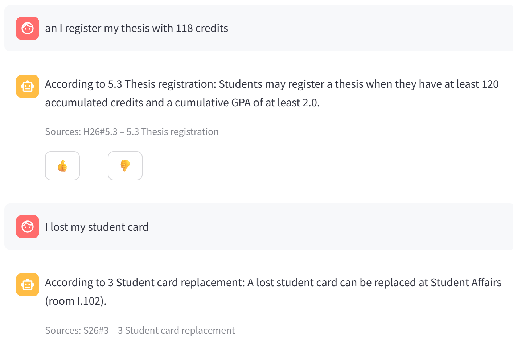
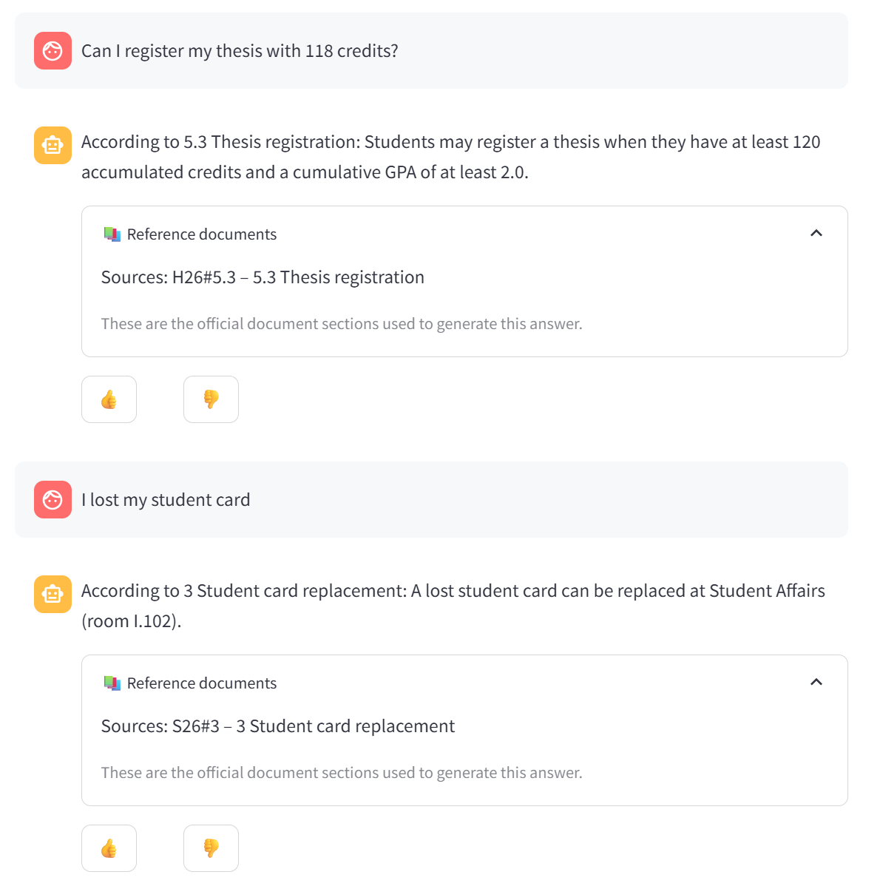

# Lab 7 homework — Usability evaluation

**Evaluation method:** Heuristic evaluation and simulated user scenarios.

**Date:** 26/11/2026

**Task:** Find out if you can register your thesis with 118 credits, and where to replace a lost student card.

| # | Potential user misunderstanding | What the user would expect | Why the system/UI caused it | Fix idea |
|---|---|---|---|---|
| 1 | The user may be uncertain whether 118 credits are sufficient for thesis registration. | A direct yes-or-no answer followed by an explanation. | The assistant provides the relevant regulation without explicitly stating the eligibility decision. | Provide a direct conclusion before presenting the regulation. |
| 2 | The user may overlook or misunderstand the document reference, such as H26#5.3. | A clearly identified reference section explaining the origin of the answer. | Sources are displayed as small captions with technical document identifiers. | Display sources in a dedicated reference section with explanatory text. |
| 3 | The user may expect additional information about replacing a lost student card, such as the required fee or processing time. | Clear guidance on the replacement procedure. | The answer only provides the office name and room number without additional procedural details. | Include relevant procedural information when available in the source document. |

## The one change we made

Planned improvement: Introduce a dedicated, expandable reference section with explanatory text to make answer sources more visible and understandable.

**Commit link:** [To be added after implementation]

## Before / After screenshots

### Before

### After
